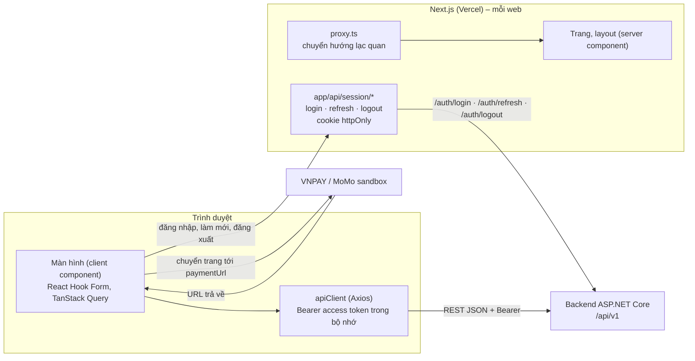
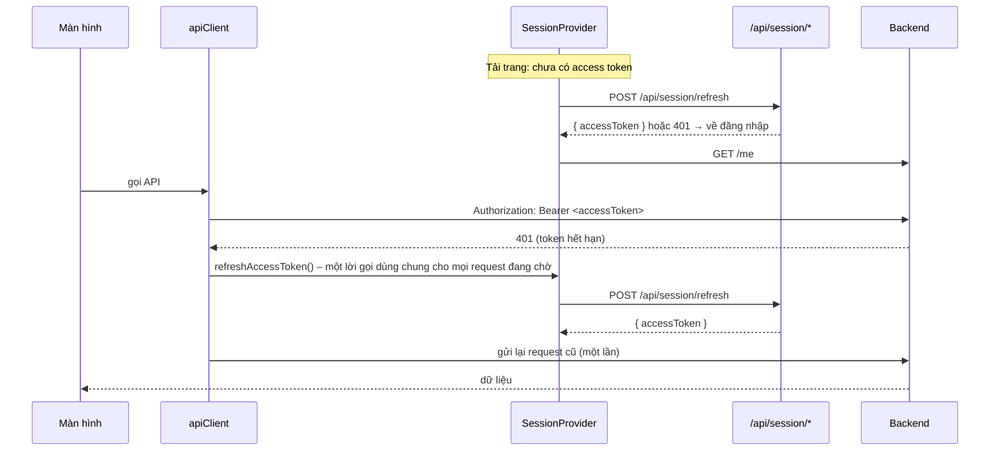

# Frontend Architecture – Hệ thống quản lý spa thú cưng

*Cách tổ chức 3 web Next.js: công nghệ, thư mục, định tuyến, trạng thái, phiên đăng nhập, gọi API, cấu hình, chạy và triển khai* · Phiên bản 1.0 · Ngày lập: 21/10/2026

**Nguồn:** *System Analysis & UI Design v1.3* (**SA**: 3.1 – 3.3, 5.1, 6.6, 7.1), *Authorization* (**Auth**: 2, 3, 9), `API-Notes.md`, `openapi.yaml`, *Definition of Done* (**DoD**), mã nguồn `frontend/customer-web`, `frontend/staff-web`, `frontend/manager-web` trên nhánh `develop` (README, `package.json`, `next.config.ts`, `lib/`, `components/`), tài liệu Next.js 16 đi kèm gói (`node_modules/next/dist/docs/`).
**Nhãn:** **(Đề xuất)** tài liệu này đề xuất, chờ nhóm duyệt · **(Hiện có)** đã có trong mã trên `develop`.
**Tài liệu đi kèm:** `User-Flows.md` (màn, đường dẫn), `UI-Screens.md` (hành vi từng màn), `Design-System.md` (token, thành phần), `Frontend-Conventions.md` (quy ước viết mã).

---

## 1. Tổng quan

- **3 ứng dụng Next.js độc lập** trong một repository: `frontend/customer-web` (KH), `frontend/staff-web` (LT, NVS), `frontend/manager-web` (QL). Mỗi web một project Vercel, một origin (SA 3.2).
- Web **chỉ gọi backend** ASP.NET Core qua REST/JSON `https://<backend>/api/v1` (Axios); không truy cập CSDL, không gọi cổng thanh toán trực tiếp (SA 3.1, C-02).
- Web là **ứng dụng chạy phía trình duyệt**: khung trang (layout, menu) dựng sẵn ở server; dữ liệu nghiệp vụ tải ở trình duyệt bằng TanStack Query với access token trong bộ nhớ. Server của Next.js chỉ làm 3 việc: trả trang, chuyển hướng lạc quan (`proxy.ts`), giữ refresh token trong cookie httpOnly (mục 6) **(Đề xuất)**.
- **Backend là nơi quyết định**: quyền, trạng thái, số tiền, nhóm kích cỡ, mốc giờ còn chỗ. Web chỉ kiểm tra để phản hồi nhanh và hiển thị (Auth 2, SA 6.6).



---

## 2. Công nghệ và phiên bản

Phiên bản lấy từ `package.json` của 3 web (giống nhau) **(Hiện có)**; danh sách thư viện theo SA 3.3 – không thêm thư viện ngoài danh sách nếu nhóm chưa duyệt.

| Hạng mục | Công nghệ | Phiên bản | Ghi chú |
| --- | --- | --- | --- |
| Framework | Next.js (App Router) | 16.4.2 | `cacheComponents: true`, `partialPrefetching: true` trong `next.config.ts`; Turbopack. |
| Giao diện | React, React DOM | 19.3.0 | |
| Ngôn ngữ | TypeScript | ^5 | `strict: true`, đường dẫn tắt `@/*` → thư mục gốc của web. |
| CSS | TailwindCSS v4 | ^4 | Nạp qua `@tailwindcss/turbopack`; token trong `@theme` của `app/globals.css`. |
| Gọi API | Axios | ^1.20.0 | Một `apiClient` mỗi web. |
| Dữ liệu từ server | TanStack Query | ^5.104 | `QueryClientProvider` trong `app/providers.tsx`. |
| Form | React Hook Form | ^7.90.0 | Kiểm tra bằng luật có sẵn của RHF (không thêm thư viện schema – Frontend-Conventions mục 4). |
| Phông | `next/font/google` – Be Vietnam Pro | – | |
| Kiểm tra mã | ESLint 9 + `eslint-config-next` (core-web-vitals, typescript) | 16.4.2 | `npm run lint`. |
| Node.js | ≥ 20 (máy nhóm đang dùng 24) | – | |

**Lưu ý Next.js 16** (ghi trong `AGENTS.md` của web): API khác bản cũ, đọc tài liệu trong `node_modules/next/dist/docs/` trước khi dùng tính năng chưa quen. Những điểm đã gặp:

- Middleware đổi tên thành **Proxy** (`proxy.ts`, hàm `proxy`).
- `params`, `searchParams` của `page`/`layout` là **Promise**; kiểu toàn cục `PageProps<'/đường-dẫn'>`, `LayoutProps<'/'>` được sinh khi build (`npm run build` hoặc `npx next typegen` trước `npx tsc --noEmit` – DoD mục B).
- Với `cacheComponents`, client component đọc `usePathname`, `useSearchParams`, `useParams` phải nằm trong `<Suspense>` (đã làm ở `SiteHeader`).
- `cookies()`, `headers()` là hàm bất đồng bộ.
- Chuyển hướng cố định dùng `redirects()` trong `next.config.ts` thay vì `redirect()` trong `page.tsx` (`staff-web` chuyển `/` → `/lich-hen`).

---

## 3. Tổ chức mã nguồn

### 3.1 Cấu trúc thư mục của một web

Áp dụng giống nhau cho cả 3 web **(Đề xuất; thư mục có dấu ✓ đã có)**. Nguyên tắc: **API theo tài nguyên** (`lib/api`, `lib/queries`), **giao diện theo tính năng** (`features`).

```
frontend/<web>/
├── app/                                ✓ App Router
│   ├── layout.tsx                      ✓ <html lang="vi">, phông, <Providers>
│   ├── providers.tsx                   ✓ QueryClientProvider, ToastProvider, SessionProvider
│   ├── globals.css                     ✓ @theme token + kiểu gốc (Design-System 2)
│   ├── not-found.tsx, error.tsx        trang 404, lỗi không bắt được (có nút Thử lại)
│   ├── (auth)/                         nhóm màn KHÔNG khung
│   │   └── dang-nhap/page.tsx          (CW thêm dang-ky/page.tsx)
│   ├── (main)/                         ✓ nhóm màn CÓ khung (MW hiện đặt tên (dashboard) – đổi thành (main))
│   │   ├── layout.tsx                  ✓ khung (SiteHeader / Sidebar) + SessionGate
│   │   └── <đường-dẫn>/page.tsx        trang mỏng: render <XxxScreen />
│   └── api/session/                    route handler phiên đăng nhập (mục 6)
│       ├── login/route.ts
│       ├── refresh/route.ts
│       └── logout/route.ts
├── components/
│   ├── ui/                             thành phần cơ bản (Design-System 4.1)
│   ├── feedback/                       ✓ ErrorAlert, FieldError, ForbiddenState, Toast…
│   ├── domain/                         thành phần nghiệp vụ (Design-System 4.3)
│   ├── layout/                         ✓ SiteHeader, HeaderNav, Dropdown / Sidebar
│   └── icons.tsx                       ✓ Icon, PawLogo
├── features/
│   └── <tính-năng>/                    ví dụ pets, booking, appointments, check-in
│       ├── screens/                    một file mỗi màn: pets-screen.tsx (CW-04)…
│       ├── components/                 thành phần chỉ tính năng này dùng
│       └── forms.ts                    giá trị mặc định, luật kiểm tra, chuyển form ↔ request
├── lib/
│   ├── api/
│   │   ├── client.ts                   ✓ apiClient (Axios) + interceptor
│   │   ├── errors.ts                   ✓ ApiError, toApiError, getErrorMessage, ERROR_CODES
│   │   ├── types.ts                    kiểu request/response chép đúng openapi.yaml (mục 7.2)
│   │   └── endpoints/<tài-nguyên>.ts   hàm gọi API: appointments.ts, pets.ts, payments.ts…
│   ├── queries/<tài-nguyên>.ts         query key + hook useQuery/useMutation
│   ├── auth/                           SessionProvider, useSession, SessionGate, RoleGate
│   ├── query-client.ts                 ✓ cấu hình TanStack Query
│   ├── routes.ts                       ✓ ROUTES + hàm tạo đường dẫn động
│   ├── format.ts                       tiền, ngày, giờ (Frontend-Conventions 7)
│   ├── labels.ts                       nhãn enum (UI-Screens 2.4)
│   ├── time.ts                         múi giờ cửa hàng, dựng ISO 8601 (mục 8)
│   ├── validation.ts                   luật kiểm tra dùng chung (SĐT, cân nặng…)
│   ├── store-info.ts                   hotline, địa chỉ, giờ mở cửa, tài khoản QR (UI-Screens G-16)
│   └── staff-role.ts                   ✓ (chỉ SW) StaffRole, nhãn vai trò
├── proxy.ts                            chuyển hướng lạc quan theo cookie phiên (mục 6.4)
├── next.config.ts                      ✓
├── .env.example                        ✓ NEXT_PUBLIC_API_BASE_URL
├── eslint.config.mjs, tsconfig.json    ✓
└── README.md, AGENTS.md                ✓
```

**Tính năng theo web (gợi ý tên thư mục `features/`):**

| Web | Tính năng → màn |
| --- | --- |
| Khách hàng | `auth` (CW-01, 02) · `home` (CW-03) · `pets` (CW-04, 05) · `booking` (CW-06, 07) · `appointments` (CW-08, 09, 10) · `history` (CW-11) · `notifications` (CW-12) · `profile` (CW-13) |
| Nhân viên | `auth` (SW-01) · `appointments` (SW-02, 03) · `customers` (SW-04, 05) · `booking` (SW-06) · `check-in` (SW-07) · `cages` (SW-08) · `payments` (SW-09) · `check-out` (SW-10) · `service-execution` (SW-11) · `work-history` (SW-12) · `notifications` (SW-13) · `services` (SW-14) · `profile` (SW-15) |
| Quản lý | `auth` (MW-01) · `dashboard` (MW-02) · `appointments` (MW-03, 05) · `pending` (MW-04) · `services` (MW-06) · `cages` (MW-07) · `staff` (MW-08) · `locked-customers` (MW-09) · `payments` (MW-10) · `profile` (MW-11) · `work-shifts` (MW-12) · `config` (MW-13) |

### 3.2 Quy tắc phụ thuộc giữa thư mục

| Thư mục | Được dùng | Không được dùng |
| --- | --- | --- |
| `app/**/page.tsx`, `layout.tsx` | `features/*/screens`, `components/layout`, `lib/routes` | Gọi API, hook dữ liệu, logic nghiệp vụ |
| `features/<a>` | `components/*`, `lib/*`, `features/<a>` | `features/<b>` khác (cần dùng chung thì chuyển lên `components/domain` hoặc `lib`) |
| `components/domain` | `components/ui`, `components/feedback`, `lib/format`, `lib/labels`, `lib/api/types` | `lib/queries`, `lib/api/endpoints` (thành phần nhận dữ liệu qua props) |
| `components/ui`, `components/feedback` | `components/icons`, `lib/api/errors` (chỉ `feedback`) | Mọi thứ thuộc nghiệp vụ |
| `lib/queries` | `lib/api/endpoints`, `lib/api/types` | React component |
| `lib/api/endpoints` | `lib/api/client`, `lib/api/types` | Mọi thứ khác |

### 3.3 Mã dùng chung giữa 3 web

3 web **không** dùng gói chung; phần dùng chung được **chép** giữa các web và phải giữ giống nhau (cách `staff-web` đã làm: “chép phần dùng chung từ Web Khách hàng”) **(Hiện có)**.

| Nhóm file phải giống nhau ở 3 web | Ghi chú |
| --- | --- |
| `lib/api/client.ts`, `lib/api/errors.ts`, `lib/api/types.ts`, `lib/query-client.ts` | `ERROR_CODES` đủ 25 mã của `openapi.yaml` (SW đã có 4 mã đề xuất, CW và MW chưa). |
| `lib/api/endpoints/*`, `lib/queries/*` | Chỉ chép tài nguyên web đó dùng; cùng tài nguyên thì nội dung giống nhau. |
| `lib/auth/*`, `app/api/session/*`, `proxy.ts` | Khác nhau duy nhất ở hằng số vai trò được phép của web (`ALLOWED_ROLE`). |
| `lib/format.ts`, `lib/labels.ts`, `lib/time.ts`, `lib/validation.ts` | |
| `components/ui/*`, `components/feedback/*`, `components/domain/*`, `components/icons.tsx` | `icons.tsx` giữ đủ bộ tên (Design-System 5). |
| Khối `@theme` và `@layer base` trong `app/globals.css` | |

Quy tắc: **sửa một file dùng chung thì sửa cả 3 web trong cùng PR**, hoặc ghi rõ trong PR web nào chưa đồng bộ và thẻ sẽ đồng bộ. Gộp thành gói dùng chung (npm workspaces `frontend/shared` + `transpilePackages`) là cải tiến có thể làm sau, cần nhóm duyệt vì đổi cấu hình 3 project Vercel **(Đề xuất)**.

---

## 4. Định tuyến

### 4.1 Đường dẫn và trang

- Danh sách màn, đường dẫn, tham số: **`User-Flows.md` mục 2** (nguồn duy nhất). `lib/routes.ts` của từng web khai báo đúng bảng đó; không viết chuỗi đường dẫn rời rạc trong mã.
- Đường dẫn động tạo bằng hàm trong `lib/routes.ts` **(Đề xuất)**:

  ```ts
  export const ROUTES = {
    appointments: "/lich-hen",
    appointmentDetail: (appointmentId: string) => `/lich-hen/${appointmentId}`,
    appointmentReschedule: (appointmentId: string) => `/lich-hen/${appointmentId}/doi-lich`,
    // …
  } as const;
  ```

- `page.tsx` là server component mỏng, chỉ render màn của tính năng; màn (`features/*/screens/*-screen.tsx`) là client component (`"use client"`) đọc tham số bằng `useParams` / `useSearchParams` và tải dữ liệu bằng hook trong `lib/queries`.

  ```tsx
  // app/(main)/lich-hen/[appointmentId]/page.tsx
  import { AppointmentDetailScreen } from "@/features/appointments/screens/appointment-detail-screen";
  export default function Page() {
    return <AppointmentDetailScreen />;
  }
  ```

- Màn nào đọc `useSearchParams`/`usePathname`/`useParams` thì bọc `<Suspense fallback={<Skeleton… />}>` ở `page.tsx` (yêu cầu của `cacheComponents`).
- Bộ lọc, tab, bước, trang danh sách lưu trên **tham số truy vấn** (chia sẻ được, nút Quay lại hoạt động); cập nhật bằng `router.replace` (không thêm lịch sử) với lọc, `router.push` với bước của luồng nhiều bước.
- `loading.tsx` chỉ dùng cho khung xương khi chuyển trang; trạng thái tải dữ liệu do màn tự hiển thị (UI-Screens 2.2).

### 4.2 Chặn truy cập (route guard)

Ba lớp, lớp sau không thay lớp trước; quyền thật luôn do backend kiểm tra (Auth 2).

| Lớp | Ở đâu | Làm gì |
| --- | --- | --- |
| 1. Kiểm tra lạc quan | `proxy.ts` (chạy trước mọi trang, trừ `/api`, `/_next`, tệp tĩnh) | Trang có khung mà không có cookie phiên → chuyển `/dang-nhap?next=<đường dẫn>`. Có cookie mà mở `/dang-nhap` (hoặc `/dang-ky`) → chuyển trang đích (User-Flows 4.1). Không gọi backend, không giải mã token (hướng dẫn “Optimistic checks with Proxy” của Next.js). |
| 2. Phiên ở trình duyệt | `SessionGate` trong `app/(main)/layout.tsx` | Lấy access token (mục 6.3) và `GET /me`; chưa xong → khung xương toàn vùng nội dung; thất bại → về đăng nhập; `role` sai web → đăng xuất + báo (Auth 3.6). Cung cấp `useSession()` = `{ me, role, staffRole, logout }`. |
| 3. Vai trò trong web | `RoleGate` bọc màn (chỉ `staff-web`) | `<RoleGate allow={["Receptionist"]}>…</RoleGate>`; sai vai trò → `ForbiddenState` trong khung (User-Flows 4.2). Bảng vai trò → màn: Auth 9. Menu dùng cùng bảng (`NAV_ITEMS`). |

Lỗi 403 `FORBIDDEN` / 404 từ API do từng màn xử lý (`ForbiddenState`, `NotFoundState`).

---

## 5. Quản lý trạng thái

| Loại trạng thái | Công cụ | Quy tắc |
| --- | --- | --- |
| Dữ liệu từ server | **TanStack Query** | Mọi dữ liệu từ API đi qua `useQuery`/`useMutation` trong `lib/queries`; không chép dữ liệu server vào `useState`. |
| Phiên đăng nhập | React context `SessionProvider` (`lib/auth`) | Giữ access token **trong bộ nhớ** (biến module dùng cho `setAccessTokenProvider` của `apiClient`) và kết quả `GET /me`. |
| Trạng thái trên URL | `useSearchParams` + `lib/routes` | Bộ lọc, tab, bước, trang, mục đang chọn (`?appointmentId=`). |
| Form | React Hook Form | Giá trị nhập, lỗi trường; không đồng bộ form vào context. |
| Giao diện cục bộ | `useState` | Mở/đóng hộp thoại, menu, ô đang chọn. |
| Khách đang phục vụ (chỉ `staff-web`) | Context `ServingCustomerProvider` + `sessionStorage` (khóa `ps.servingCustomer`) | Giữ `{ customerId, fullName, phone, isBookingLocked }` khách LT chọn ở SW-04 để SW-05, SW-06 dùng (API chưa có `GET /customers/{id}` – UI-Screens G-14). Xóa khi đăng xuất. Chỉ chứa thông tin hiển thị, không chứa token. **(Đề xuất)** |

Không dùng thư viện quản lý trạng thái toàn cục (Redux, Zustand…).

### 5.1 TanStack Query

- Cấu hình chung `lib/query-client.ts` **(Hiện có)**: không thử lại lỗi 4xx; mất mạng, 5xx thử lại tối đa 3 lần. Bổ sung **(Đề xuất)**: `staleTime: 30_000`; `refetchOnWindowFocus: true` (mặc định); mutation không thử lại.
- Lỗi của query/mutation có kiểu `ApiError` (khai báo `Register.defaultError`) **(Hiện có ở CW, SW)**.
- **Khóa query** theo tài nguyên, khai báo bằng hàm tạo khóa trong `lib/queries/<tài-nguyên>.ts` **(Đề xuất)**:

  ```ts
  export const appointmentKeys = {
    all: ["appointments"] as const,
    list: (params: AppointmentListParams) => ["appointments", "list", params] as const,
    detail: (id: string) => ["appointments", "detail", id] as const,
    payments: (id: string) => ["appointments", "detail", id, "payments"] as const,
    photos: (id: string) => ["appointments", "detail", id, "photos"] as const,
    suggestions: (id: string) => ["appointments", "detail", id, "suggestions"] as const,
  };
  ```

- **Làm mới định kỳ** (SA 6.6, không có thời gian thực) **(Đề xuất)**: số thông báo chưa đọc 60 giây; MW-02, SW-02 60 giây; chi tiết lịch đang `Received`/`InProgress` 30 giây; chỉ khi tab đang hiển thị (`refetchIntervalInBackground: false`).
- **Làm mất hiệu lực sau khi ghi** (sau `onSuccess`, và sau lỗi 409 để tải lại dữ liệu mới nhất):

| Thao tác | Khóa cần làm mới |
| --- | --- |
| Tạo/sửa/gỡ thú cưng | `pets` |
| Đặt lịch, đổi lịch, hủy, từ chối, xác nhận | `appointments` (danh sách + chi tiết), `spa-slots`, `hotel-availability` |
| Tiếp nhận, đối chiếu cân nặng, phản hồi chi phí, bắt đầu, đánh dấu dịch vụ, hoàn tất, trả thú cưng | `appointments.detail(id)` (gồm `payments`, `photos`), danh sách lịch hẹn, `cages` (lưu trú) |
| Tải ảnh | `appointments.photos(id)` |
| Ghi nhận thanh toán, khởi tạo thanh toán | `appointments.payments(id)`, `payments` |
| Dịch vụ, chuồng, giá lưu trú, nhân viên, ca làm, cấu hình | `services` · `cages` · `hotel-pricing` · `staff` · `work-shifts` · `config` |
| Đọc thông báo | `notifications` |
| Sửa hồ sơ cá nhân | `me` |

---

## 6. Xác thực và phiên đăng nhập

Cơ chế lưu phiên ở web chưa chốt (R-01; mã hiện tại ghi “Nơi lưu và làm mới token chưa chốt” và để thẻ đăng nhập quyết định). Phần này là **(Đề xuất)** để nhóm duyệt trước khi làm thẻ đăng nhập (`customer-web` 1.5.2.1, `staff-web` thẻ 121).

### 6.1 Nguyên tắc

- **Access token** (JWT, 15 phút – Auth 3.1) chỉ nằm **trong bộ nhớ** trình duyệt, mất khi tải lại trang.
- **Refresh token** (7 ngày, xoay vòng) nằm trong **cookie httpOnly** do chính web đặt qua route handler của Next.js; JavaScript của trang không đọc được → giảm rủi ro bị đánh cắp khi có lỗi XSS. Không lưu token vào `localStorage`/`sessionStorage`.
- Backend không đổi: route handler gọi đúng `POST /auth/login`, `/auth/refresh`, `/auth/logout` như `openapi.yaml`.

### 6.2 Route handler `app/api/session/*`

| Route | Xử lý |
| --- | --- |
| `POST /api/session/login` `{ userName, password }` | Gọi `POST /auth/login`. Lỗi → trả nguyên mã HTTP và error envelope. Thành công → gọi `GET /me` bằng access token để biết `role`; `role` không thuộc web (`Customer` / `Staff` / `Manager`) → gọi `POST /auth/logout`, trả 403 với `{ status: 403, code: "FORBIDDEN", title: "Tài khoản không có quyền truy cập web này" }`; đúng → đặt cookie, trả `{ accessToken, me }`. |
| `POST /api/session/refresh` | Đọc cookie; không có → 401. Gọi `POST /auth/refresh`; thành công → ghi đè cookie bằng refresh token mới, trả `{ accessToken }`; lỗi → xóa cookie, trả 401. |
| `POST /api/session/logout` | Đọc cookie, gọi `POST /auth/logout` (bỏ qua lỗi), xóa cookie, trả 204. |

**Cookie:** tên `ps_rt`; `HttpOnly`; `Secure` (trừ khi chạy `http://localhost`); `SameSite=Lax` (cần cho lần quay về từ cổng thanh toán – UF-11); `Path=/`; `Max-Age` = 7 ngày. Route handler chỉ nhận yêu cầu cùng origin (kiểm tra header `Origin`) **(Đề xuất)**.

### 6.3 Ở trình duyệt



- `apiClient` **(Hiện có: gắn Bearer qua `setAccessTokenProvider`)** thêm interceptor phản hồi: gặp 401 ở request không thuộc `/auth/*`, chưa thử lại → chờ `refreshAccessToken()` (chỉ một lời gọi làm mới tại một thời điểm) → gửi lại một lần. Làm mới thất bại → `SessionProvider` xóa bộ đệm TanStack Query (`queryClient.clear()`), xóa khách đang phục vụ, chuyển `/dang-nhap?next=…` và báo “Phiên đăng nhập đã hết hạn, vui lòng đăng nhập lại.”
- Sau khi đăng nhập: lưu `accessToken` vào bộ nhớ, đặt `me` vào context, `router.replace(next ?? trang đích)`.
- Đăng xuất: `POST /api/session/logout` → xóa token, bộ đệm, khách đang phục vụ → `/dang-nhap`.

### 6.4 `proxy.ts`

```ts
// Kiểm tra lạc quan: chỉ xem có cookie phiên hay không, không giải mã, không gọi backend.
import { NextResponse, type NextRequest } from "next/server";

const PUBLIC_PATHS = ["/dang-nhap"]; // customer-web thêm "/dang-ky"

export function proxy(request: NextRequest) {
  const { pathname, search } = request.nextUrl;
  const hasSession = request.cookies.has("ps_rt");
  const isPublic = PUBLIC_PATHS.includes(pathname);
  if (!isPublic && !hasSession) {
    const url = new URL("/dang-nhap", request.url);
    url.searchParams.set("next", pathname + search);
    return NextResponse.redirect(url);
  }
  if (isPublic && hasSession) return NextResponse.redirect(new URL("/", request.url));
  return NextResponse.next();
}

export const config = { matcher: ["/((?!api|_next/static|_next/image|.*\\..*).*)"] };
```

(`staff-web`: `/` đã được `next.config.ts` chuyển về `/lich-hen`.)

### 6.5 Phương án dự phòng

Nếu nhóm không dùng route handler: lưu refresh token trong `sessionStorage` (mất khi đóng tab, vẫn bị đọc được khi có XSS), access token trong bộ nhớ, `apiClient` gọi thẳng `POST /auth/refresh`; bỏ `proxy.ts`, `SessionGate` tự chuyển hướng. Cần ghi rõ rủi ro trong quyết định R-01.

---

## 7. Gọi API

### 7.1 `apiClient` và lỗi

- Mọi lời gọi backend đi qua `apiClient` (`lib/api/client.ts`, `baseURL` = `NEXT_PUBLIC_API_BASE_URL`, gồm `/api/v1`) **(Hiện có)**. Ngoại lệ duy nhất: route handler phiên (mục 6.2) gọi backend bằng `fetch` ở server.
- Interceptor phản hồi chuẩn hóa mọi lỗi thành `ApiError` (`kind`, `status`, `code`, `title`, `detail`) **(Hiện có)**; màn hình hiển thị bằng `getErrorMessage` / `ErrorAlert` / `useToast().showError` (Frontend-Conventions mục 5).
- Không đặt `Content-Type` mặc định cho multipart: tải ảnh truyền `FormData`, Axios tự đặt `multipart/form-data` có boundary (mã hiện tại đặt mặc định `application/json` ở `customer-web`, `staff-web` – chỉ áp cho JSON).

### 7.2 Kiểu dữ liệu

- `lib/api/types.ts` chép **đúng tên và kiểu** các schema trong `openapi.yaml` (`Appointment`, `AppointmentDetail`, `SpaSlots`, `ProblemDetails`, enum `AppointmentStatus`…). Enum viết bằng union chuỗi; trường `nullable` → `T | null`; trường không bắt buộc → `?`. Tiền là `number` (số nguyên VND); thời gian là `string` ISO 8601.

  ```ts
  export type AppointmentStatus = "Pending" | "Confirmed" | "Received" | "InProgress" | "InStay" | "Completed" | "Cancelled";
  export type Page<T> = { items: T[]; page: number; pageSize: number; total: number };
  ```

- Sinh kiểu tự động từ `openapi.yaml` bằng `openapi-typescript` là tùy chọn, cần nhóm duyệt vì thêm thư viện **(Đề xuất)**; khi đó vẫn giữ tên kiểu như trên bằng bí danh.
- `openapi.yaml` đổi → sửa `types.ts` của cả 3 web trong cùng PR với thay đổi dùng nó.

### 7.3 Hàm gọi API và hook

```ts
// lib/api/endpoints/appointments.ts – chỉ gọi API, không có logic giao diện
export async function getAppointment(id: string) {
  const { data } = await apiClient.get<AppointmentDetail>(`/appointments/${id}`);
  return data;
}

// lib/queries/appointments.ts – hook dùng trong màn
export function useAppointment(id: string) {
  return useQuery({ queryKey: appointmentKeys.detail(id), queryFn: () => getAppointment(id) });
}
```

- Một hàm cho một operation của `openapi.yaml`; tên hàm theo `operationId` (`getAppointment`, `createSpaAppointment`, `respondCostConfirmation`…).
- Tham số danh sách truyền bằng object đúng tên API (`{ type, status, date, petId, page, pageSize }`); `serviceIds` gửi dạng `a,b,c` (`style: form, explode: false`).
- Request **không** có `role`, `sizeGroup`, `status`, `amount`; `staffIds`, `cageId` chỉ có ở hàm của QL (API-Notes 3, DoD mục B).
- Phân trang: `pageSize` mặc định 20 cho bảng, 100 cho danh sách trong ngày và danh mục nhỏ (cửa hàng một chi nhánh) **(Đề xuất)**.

---

## 8. Thời gian và múi giờ

- Mọi thời gian hiển thị và nhập theo **múi giờ cửa hàng** `Asia/Ho_Chi_Minh` (`App__TimeZone` – Backend-Architecture 10), không theo múi giờ máy người dùng. Hằng số `STORE_TIME_ZONE` trong `lib/time.ts`.
- Gửi lên API: chuỗi ISO 8601 **có độ lệch** `+07:00`, ví dụ `slotStart: "2026-10-06T09:00:00+07:00"` (SA 5.1.4). `lib/time.ts` có hàm dựng từ ngày + giờ đã chọn; không dùng `Date.prototype.toISOString()` (ra UTC `Z`) cho giá trị người dùng chọn.
- Tham số `date` (`YYYY-MM-DD`) tính theo ngày ở múi giờ cửa hàng.
- Định dạng bằng `Intl.DateTimeFormat("vi-VN", { timeZone: STORE_TIME_ZONE, … })`; không thêm thư viện ngày giờ.
- Đếm ngược tính từ `expiresAt` của backend so với giờ máy; hết giờ thì tải lại từ backend (SA 6.6).

---

## 9. Tích hợp đặc biệt

| Tính năng | Cách làm |
| --- | --- |
| Thanh toán trực tuyến (UF-11) | `POST /payments/{id}/online` → `window.location.assign(paymentUrl)`. Trang trả về `/lich-hen/{appointmentId}?payment=return` (cần BE chốt URL – UI-Screens G-15): hỏi lại `GET /appointments/{id}/payments` tối đa 5 lần, cách 2 giây, đến khi `Paid`; vẫn `Unpaid` → thẻ “Thanh toán chưa thành công”. Web không tự đánh dấu đã thanh toán. |
| Tải ảnh minh chứng (SW-11) | Chỉ nhận `image/*`; thu nhỏ bằng `canvas` (cạnh dài 1600px, JPEG 0,8) trước khi gửi (SA 3.2: “nén, thu nhỏ ảnh trước khi tải lên”) **(Đề xuất)**; `FormData { kind, file }`; thanh tiến trình bằng `onUploadProgress` của Axios. Ảnh xem bằng `url` tạm thời từ `GET /appointments/{id}/photos`; dùng thẻ `img` thường (URL có hạn, không qua tối ưu ảnh của Next.js). |
| Thông báo | Hỏi định kỳ (mục 5.1); không WebSocket/SSE (SA 6.6). |
| Đồng hồ đếm ngược | Thành phần `Countdown` (Design-System 4.2). |

---

## 10. Biến môi trường

| Biến | Web | Bắt buộc | Ý nghĩa |
| --- | --- | --- | --- |
| `NEXT_PUBLIC_API_BASE_URL` | Cả 3 | Có | URL backend gồm `/api/v1`, ví dụ `https://<backend>.onrender.com/api/v1` **(Hiện có trong `.env.example`)**. Dùng ở trình duyệt và ở route handler phiên. |

- Biến bắt đầu bằng `NEXT_PUBLIC_` được nhúng vào mã gửi cho trình duyệt: **không** đặt secret ở web. Web không có secret nào (secret ở backend – SA 7.2 D).
- `.env.local` không đưa lên Git (`.gitignore` gốc đã chặn `.env`, `.env.local`); luôn cập nhật `.env.example` khi thêm biến (DoD mục A).
- Thông tin cửa hàng (hotline, địa chỉ, tài khoản nhận chuyển khoản) không phải secret: để trong `lib/store-info.ts` (UI-Screens G-16).

---

## 11. Chạy, kiểm tra, build

Trong thư mục từng web:

```bash
npm install
```

```bash
cp .env.example .env.local
```

```bash
npm run dev
```

```bash
npm run lint
```

```bash
npm run build
```

```bash
npx tsc --noEmit
```

- `npm run dev` mặc định cổng 3000. Chạy cả 3 web cùng lúc thì dùng cổng riêng **(Đề xuất)**: khách hàng 3000, nhân viên 3001 (`npx next dev -p 3001`), quản lý 3002 (`npx next dev -p 3002`); backend phải cho phép CORS cả 3 origin `http://localhost:300x` ở môi trường phát triển.
- Trước khi mở PR (DoD mục B): `npm run lint`, `npx tsc --noEmit` (sau `npm run build` hoặc `npx next typegen` ở bản mới tải), `npm run build` đều sạch; kiểm tra không cuộn ngang ở 1024px và 375px.
- Kiểm thử tự động: chưa có công cụ; sẽ chốt ở `TestingStrategy.md` (#15).

---

## 12. Triển khai

- **Vercel Hobby**, 3 project từ cùng repository, mỗi project đặt **Root Directory** là `frontend/customer-web`, `frontend/staff-web`, `frontend/manager-web` (SA 3.2, X-05). Build mặc định của Next.js.
- Mỗi project khai báo `NEXT_PUBLIC_API_BASE_URL` trỏ backend Render.
- Backend đặt `Cors__AllowedOrigins` = đúng 3 domain `*.vercel.app` của 3 project (SA 7.2 D).
- Request đầu tiên sau khi backend Render “ngủ” có thể chậm khoảng một phút (SA 3.2): màn hiển thị khung xương; không đặt thời gian chờ Axios ngắn hơn 60 giây **(Đề xuất)**.

---

## 13. Hiện trạng mã và việc cần làm để khớp tài liệu

| # | Việc | Web | Ghi chú |
| --- | --- | --- | --- |
| A-01 | Sửa menu và đường dẫn web quản lý theo User-Flows 2.3 (gộp lịch spa/lưu trú, bỏ `/tinh-trang-chuong`, thêm MW-01, 04, 05, 11, 12, 13, số chờ xử lý, khối tài khoản). | MW | |
| A-02 | Đồng bộ phần dùng chung với CW: token `@theme`, kiểu gốc, `ToastProvider`, `FieldError`, `ForbiddenState`, `ErrorAlert` có kiểu 429, `errors.ts` đầy đủ, `client.ts` có `setAccessTokenProvider`, khai báo `Register.defaultError`; README theo mẫu CW; đổi `(dashboard)` → `(main)`, `narrow:` → `max-[980px]:`. | MW | Design-System 9 |
| A-03 | Thêm 4 mã lỗi đề xuất (`STAFF_OUT_OF_SHIFT`, `CUSTOMER_NOT_LOCKED`, `DUPLICATE_CAGE_CODE`, `COST_CONFIRMATION_EXPIRED`) vào `ERROR_CODES`. | CW, MW | Đã có trong `openapi.yaml`, SW |
| A-04 | Làm cơ chế phiên mục 6 (route handler, `SessionProvider`, `SessionGate`, `proxy.ts`, interceptor 401) – sau khi nhóm chốt R-01. | Cả 3 | Thẻ đăng nhập của từng web |
| A-05 | Truyền vai trò thật vào `HeaderNav` (đang `role = null`), thêm `RoleGate`. | SW | Sau A-04 |
| A-06 | Thêm `lib/format.ts`, `labels.ts`, `time.ts`, `validation.ts`, `store-info.ts`, `lib/api/types.ts` và thành phần `components/ui` cơ bản (Button, Badge, Card, Field, Input, Modal…) trước khi làm màn đầu tiên dùng chúng. | Cả 3 | Nên làm cùng module mẫu (#16) |
| A-07 | Bỏ `Content-Type: application/json` mặc định khi gửi `FormData` (tải ảnh). | SW | Mục 7.1 |

---

## 14. Điểm cần chốt

| # | Vấn đề | Đề xuất | Mục |
| --- | --- | --- | --- |
| F-01 | Lưu phiên (R-01) | Refresh token trong cookie httpOnly qua route handler; access token trong bộ nhớ. | 6 |
| F-02 | Mã dùng chung giữa 3 web | Tiếp tục chép, sửa cả 3 web trong cùng PR; xem xét gói dùng chung sau. | 3.3 |
| F-03 | Sinh kiểu từ `openapi.yaml` | Viết tay theo openapi; `openapi-typescript` nếu nhóm duyệt. | 7.2 |
| F-04 | Thời gian làm mới định kỳ, `staleTime`, `pageSize` | 60 giây / 30 giây; 30 giây; 20 và 100. | 5.1, 7.3 |
| F-05 | Thu nhỏ ảnh trước khi tải | 1600px, JPEG 0,8. | 9 |
| F-06 | Cổng chạy 3 web khi phát triển | 3000 / 3001 / 3002. | 11 |
