# User Flows – Hệ thống quản lý spa thú cưng

*Danh sách màn hình, điều hướng và luồng nhiều bước của 3 web* · Phiên bản 1.0 · Ngày lập: 21/10/2026

**Nguồn:** *System Analysis & UI Design v1.3* (**SA**: 6.2, 6.3, 6.6), *Authorization* (**Auth**: 3.3, 3.6, 9), *Use Case* (**UC**), *API-Notes*, `openapi.yaml`, **UI demo** `docs/SE358_PetSpa_UI_Demo.html` (bản giao diện nhóm đã chốt, mục OV-01 “Sơ đồ màn hình và luồng chính”), mã nguồn 3 web trên nhánh `develop` (`frontend/*/lib/routes.ts`).
**Nhãn:** **(Đề xuất)** nội dung tài liệu này đề xuất, nguồn chưa quy định, chờ nhóm duyệt · **(Suy ra)** suy ra từ nguồn, nguồn không ghi trực tiếp.
**Tài liệu FE đi kèm:** `UI-Screens.md` (hành vi từng màn), `wireframes/` (ảnh bố cục), `Design-System.md`, `Frontend-Architecture.md`, `Frontend-Conventions.md`.

---

## 1. Quy ước

| Hạng mục | Quy ước |
| --- | --- |
| Mã màn hình | Giữ mã đã dùng ở SA 6.2, UI demo và mã nguồn: **CW-xx** (web khách hàng), **SW-xx** (web nhân viên), **MW-xx** (web quản lý). Các mã này thay cho mã `SCR-xx` trong hướng dẫn chung. |
| Mã hộp thoại | `<mã màn>·D<n>`, ví dụ `CW-09·D3` (hộp thoại thứ 3 mở từ CW-09) **(Đề xuất)**. |
| Mã luồng | **UF-01 → UF-07** giữ nguyên SA 6.3; **UF-08 → UF-11** bổ sung cho phần giao diện **(Đề xuất)**. |
| Đường dẫn | Chữ thường, không dấu, nối gạch ngang, đúng như `lib/routes.ts` hiện có (`/dat-lich/spa`, `/lich-su-cong-viec`). Tham số động dùng tên trường API: `[appointmentId]`, `[petId]`, `[customerId]`. |
| Tham số truy vấn | Tham số chuyển thẳng cho API dùng **đúng tên của API**: `petId`, `customerId`, `appointmentId`, `type`, `status`, `date`. Tham số chỉ dùng cho giao diện: `tab`, `step`, `week`, `group`, `next` **(Đề xuất)**. |
| Ba web độc lập | Mỗi web một ứng dụng Next.js, một origin riêng; không có liên kết giữa các web. Tài khoản đăng nhập nhầm web xử lý theo mục 4.2. |
| Khung trang | **Có khung**: thanh trên (CW, SW) hoặc thanh bên (MW) + vùng nội dung. **Không khung**: màn đăng nhập/đăng ký (`data-chrome="none"` trong UI demo). |

---

## 2. Danh sách màn hình

Ảnh bố cục từng màn nằm ở `wireframes/<mã>-<tên>.png`; mô tả vùng và hành vi ở `UI-Screens.md` cùng mã.

### 2.1 Web khách hàng (CW)

| Mã | Tên màn hình | Đường dẫn | Khung | Truy cập | UC |
| --- | --- | --- | --- | --- | --- |
| CW-01 | Đăng ký | `/dang-ky` | Không | Ẩn danh | UC-01 |
| CW-02 | Đăng nhập | `/dang-nhap` | Không | Ẩn danh | UC-02 |
| CW-03 | Trang chủ: danh mục dịch vụ & giá lưu trú | `/` | Có | KH | UC-09 |
| CW-04 | Thú cưng của tôi | `/thu-cung` | Có | KH | UC-06, UC-07 |
| CW-05 | Tạo / sửa hồ sơ thú cưng | `/thu-cung/them`, `/thu-cung/[petId]/sua` | Có | KH | UC-05, UC-06 |
| CW-06 | Đặt lịch spa (3 bước) | `/dat-lich/spa` (`?petId=`, `?step=1\|2\|3`) | Có | KH | UC-10 |
| CW-07 | Đặt lịch lưu trú | `/dat-lich/luu-tru` (`?petId=`) | Có | KH | UC-28 |
| CW-08 | Lịch hẹn của tôi | `/lich-hen` (`?tab=upcoming\|completed\|cancelled`, `?type=Spa\|Hotel`) | Có | KH | UC-11 |
| CW-09 | Chi tiết lịch hẹn | `/lich-hen/[appointmentId]` | Có | KH | UC-11, 14, 19, 24, 25, 30 |
| CW-10 | Đổi lịch hẹn | `/lich-hen/[appointmentId]/doi-lich` | Có | KH | UC-14 |
| CW-11 | Lịch sử dịch vụ | `/lich-su` (`?petId=`) | Có | KH | UC-11 |
| CW-12 | Thông báo | `/thong-bao` | Có | KH | UC-34 |
| CW-13 | Hồ sơ cá nhân | `/ho-so` | Có | KH | UC-03 |

Đường dẫn CW-05 (`/them`, `/[petId]/sua`), CW-09, CW-10 và các tham số truy vấn là **(Đề xuất)**; các đường dẫn còn lại đã có trong `customer-web/lib/routes.ts`.

### 2.2 Web nhân viên (SW)

LT: lễ tân · NVS: nhân viên spa (Auth 9).

| Mã | Tên màn hình | Đường dẫn | Khung | Vai trò | UC |
| --- | --- | --- | --- | --- | --- |
| SW-01 | Đăng nhập | `/dang-nhap` | Không | Ẩn danh | UC-02 |
| SW-02 | Lịch hẹn (LT: cả cửa hàng · NVS: được phân công) | `/lich-hen` (`?date=`); `/` chuyển về đây | Có | LT, NVS | UC-11 |
| SW-03 | Chi tiết lịch hẹn | `/lich-hen/[appointmentId]` | Có | LT, NVS | UC-06, UC-11, UC-25 |
| SW-04 | Khách hàng: tìm, ghi nhận khách vãng lai | `/khach-hang` (`?search=`) | Có | LT | UC-04 |
| SW-05 | Hồ sơ thú cưng | `/khach-hang/[customerId]/thu-cung/them`, `/khach-hang/[customerId]/thu-cung/[petId]` | Có | LT | UC-05, UC-06 |
| SW-06 | Đặt lịch thay khách | `/dat-lich` (`?customerId=&petId=&type=Spa\|Hotel`) | Có | LT | UC-10, UC-28 |
| SW-07 | Tiếp nhận & cân nặng | `/tiep-nhan` (`?appointmentId=`) | Có | LT | UC-16, 17, 30, 31 |
| SW-08 | Tình trạng chuồng | `/chuong` | Có | LT | UC-33 |
| SW-09 | Thanh toán tại quầy | `/thanh-toan` (`?appointmentId=`) | Có | LT | UC-23, UC-25 |
| SW-10 | Trả thú cưng lưu trú | `/tra-thu-cung` (`?appointmentId=`) | Có | LT | UC-32 |
| SW-11 | Thực hiện dịch vụ | `/lich-hen/[appointmentId]/thuc-hien` | Có | NVS | UC-18, UC-19 |
| SW-12 | Lịch sử công việc | `/lich-su-cong-viec` | Có | NVS | UC-11 |
| SW-13 | Thông báo | `/thong-bao` | Có | NVS | UC-34 |
| SW-14 | Danh mục dịch vụ | `/dich-vu` | Có | LT, NVS | UC-09 |
| SW-15 | Hồ sơ cá nhân | `/ho-so` | Có | LT, NVS | UC-03 |

Đường dẫn gốc của 15 màn đã có trong `staff-web/lib/routes.ts`; đường dẫn con (SW-03, SW-05, SW-11) và tham số truy vấn là **(Đề xuất)**, theo ghi chú trong mã: “màn chi tiết nằm dưới đường dẫn của màn danh sách”.

### 2.3 Web quản lý (MW)

Theo SA 6.2 và UI demo. Mọi màn chỉ dành cho QL.

| Mã | Tên màn hình | Đường dẫn | Khung | UC |
| --- | --- | --- | --- | --- |
| MW-01 | Đăng nhập | `/dang-nhap` | Không | UC-02 |
| MW-02 | Tổng quan & giám sát tiến độ | `/` | Có | UC-11 |
| MW-03 | Danh sách lịch hẹn | `/lich-hen` (`?type=&status=&date=`) | Có | UC-11, UC-15 |
| MW-04 | Xử lý lịch hẹn chờ xác nhận | `/cho-xac-nhan` (`?appointmentId=&type=`) | Có | UC-12, 13, 29 |
| MW-05 | Chi tiết lịch hẹn | `/lich-hen/[appointmentId]` | Có | UC-06, 15, 19, 20, 25 |
| MW-06 | Danh mục dịch vụ | `/dich-vu` | Có | UC-08, UC-09 |
| MW-07 | Chuồng & giá lưu trú | `/chuong-va-gia` (`?tab=cages\|pricing`) | Có | UC-27, UC-33 |
| MW-08 | Nhân viên | `/nhan-vien` | Có | UC-26 |
| MW-09 | Khách hàng bị khóa | `/go-khoa-dat-lich` | Có | UC-22 |
| MW-10 | Thanh toán | `/thanh-toan` (`?status=`) | Có | UC-23, UC-25 |
| MW-11 | Hồ sơ cá nhân | `/ho-so` | Có | UC-03 |
| MW-12 | Lịch làm việc nhân viên spa | `/lich-lam-viec` (`?week=`) | Có | UC-35 |
| MW-13 | Cấu hình hệ thống | `/cau-hinh` (`?group=booking\|noshow\|weight\|hotel`) | Có | UC-36 |

**Chênh lệch với mã nguồn hiện tại (`manager-web/lib/routes.ts`, nhánh `develop`)** – cần sửa mã theo bảng trên (UI demo là chuẩn giao diện):

| Mã nguồn hiện tại | Theo tài liệu này |
| --- | --- |
| `/lich-spa`, `/lich-luu-tru` (hai mục menu) | Gộp thành MW-03 `/lich-hen`, lọc bằng `?type=Spa\|Hotel` như UI demo. |
| `/tinh-trang-chuong` (mục menu riêng) | Bỏ; tình trạng chuồng (UC-33) nằm trong MW-07 tab Chuồng. |
| Chưa có | Thêm MW-01 `/dang-nhap`, MW-04 `/cho-xac-nhan` (kèm số chờ xử lý trên menu), MW-05 `/lich-hen/[appointmentId]`, MW-11 `/ho-so`, MW-12 `/lich-lam-viec`, MW-13 `/cau-hinh`. |
| `/`, `/dich-vu`, `/chuong-va-gia`, `/nhan-vien`, `/go-khoa-dat-lich`, `/thanh-toan` | Giữ nguyên đường dẫn; đổi nhãn menu theo UI demo (“Tổng quan”, “Chuồng & giá”, “Khách bị khóa”). |

### 2.4 Hộp thoại và ngăn kéo

Hộp thoại xác nhận hành động nguy hiểm theo SA 6.6 (nêu hậu quả, nút Danger và nút quay lại). Đường dẫn không đổi khi mở hộp thoại.

| Mã | Tên | Mở từ | Loại | Wireframe |
| --- | --- | --- | --- | --- |
| CW-04·D1 | Gỡ hồ sơ thú cưng? | CW-04 (menu ⋯) | Modal nguy hiểm | `CW-04-d1-go-ho-so.png` |
| CW-09·D1 | Hủy lịch hẹn này? | CW-09 (nút Hủy lịch) | Modal nguy hiểm | `CW-09-d1-huy-lich.png` |
| CW-09·D2 | Từ chối chi phí mới? | CW-09 (banner xác nhận chi phí) | Modal nguy hiểm | `CW-09-d2-tu-choi-chi-phi.png` |
| CW-09·D3 | Thanh toán trực tuyến | CW-09 (nút Thanh toán trực tuyến) | Modal | `CW-09-d3-thanh-toan-truc-tuyen.png` |
| SW-07·D1 | Ghi nhận phản hồi của khách | SW-07 (đang chờ xác nhận chi phí) | Modal | `SW-07-d1-ghi-nhan-phan-hoi.png` |
| MW-04·D1 | Từ chối lịch hẹn này? | MW-04 | Modal nguy hiểm | `MW-04-d1-tu-choi.png` |
| MW-04·D2 | Nhân viên ngoài ca làm, vẫn chọn? | MW-04 (khi API trả 409 `STAFF_OUT_OF_SHIFT`) | Modal cảnh báo **(Đề xuất)** | – (mô tả ở UI-Screens) |
| MW-05·D1 | Đổi lịch spa | MW-05 | Modal | `MW-05-d1-doi-lich-spa.png` |
| MW-05·D2 | Đổi lịch lưu trú | MW-05 | Modal | `MW-05-d2-doi-lich-luu-tru.png` |
| MW-05·D3 | Hủy lịch hẹn (chọn lý do) | MW-05 | Modal nguy hiểm | `MW-05-d3-huy-lich.png` |
| MW-06·D1 | Thêm / sửa dịch vụ | MW-06 | Ngăn kéo (drawer) | `MW-06-d1-dich-vu.png` |
| MW-06·D2 | Ngừng cung cấp dịch vụ? | MW-06 | Modal cảnh báo | `MW-06-d2-ngung-dich-vu.png` |
| MW-07·D1 | Thêm / sửa chuồng | MW-07 | Modal | `MW-07-d1-chuong.png` |
| MW-08·D1 | Thêm / sửa nhân viên | MW-08 | Ngăn kéo (drawer) | `MW-08-d1-nhan-vien.png` |
| MW-08·D2 | Vô hiệu hóa tài khoản? | MW-08 | Modal nguy hiểm | `MW-08-d2-vo-hieu-hoa.png` |
| MW-09·D1 | Gỡ khóa tự đặt lịch? | MW-09 | Modal | `MW-09-d1-go-khoa.png` |
| MW-10·D1 | Ghi nhận thanh toán tại quầy | MW-10 | Modal | `MW-10-d1-thanh-toan-quay.png` |

---

## 3. Sơ đồ điều hướng

Mũi tên liền: đi qua menu hoặc nút; mũi tên đứt: chuyển tự động sau thao tác.

### 3.1 Web khách hàng

Thanh trên: **Dịch vụ** (CW-03) · **Thú cưng** (CW-04) · **Đặt lịch ▾** (Lịch spa CW-06, Lưu trú CW-07) · **Lịch hẹn** (CW-08) · chuông **Thông báo** (CW-12, kèm số chưa đọc) · menu tài khoản (**Hồ sơ cá nhân** CW-13, **Lịch sử dịch vụ** CW-11, **Đăng xuất**).

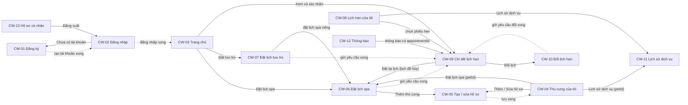

### 3.2 Web nhân viên

Thanh trên theo vai trò (UI demo `.sw-nav`, mã `NAV_ITEMS` trong `staff-web/components/layout/header-nav.tsx`):

| Mục menu | Màn | LT | NVS |
| --- | --- | --- | --- |
| Lịch hẹn | SW-02 (kèm SW-03, SW-11) | Có | Có |
| Tiếp nhận | SW-07 | Có | – |
| Trả thú cưng | SW-10 | Có | – |
| Khách hàng | SW-04 (kèm SW-05) | Có | – |
| Đặt lịch thay | SW-06 | Có | – |
| Chuồng | SW-08 | Có | – |
| Thanh toán | SW-09 | Có | – |
| Lịch sử công việc | SW-12 | – | Có |
| Dịch vụ | SW-14 | Trong menu tài khoản | Có |
| Chuông thông báo | SW-13 | – | Có |
| Menu tài khoản: Hồ sơ cá nhân, Đăng xuất | SW-15 | Có | Có |

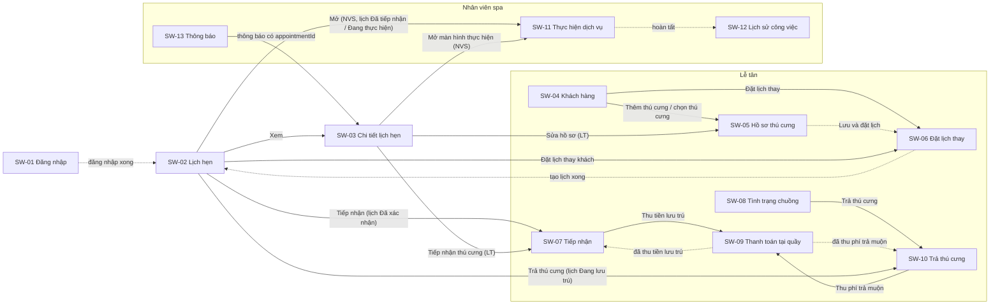

### 3.3 Web quản lý

Thanh bên theo UI demo: **Tổng quan** (MW-02) · **Lịch hẹn** (MW-03, kèm MW-05) · **Chờ xác nhận** (MW-04, kèm số lịch Chờ xác nhận) · **Dịch vụ** (MW-06) · **Chuồng & giá** (MW-07) · **Nhân viên** (MW-08) · **Lịch làm việc** (MW-12) · **Khách bị khóa** (MW-09) · **Thanh toán** (MW-10) · **Cấu hình** (MW-13); cuối thanh bên: tên tài khoản (MW-11) và nút **Đăng xuất**.

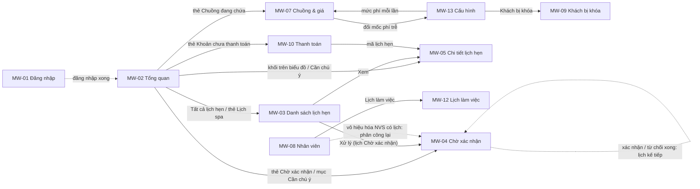

---

## 4. Điều hướng theo vai trò và xác thực

### 4.1 Trang đích sau đăng nhập

| Web | Vai trò hợp lệ (`Role` trong token / `GET /me`) | Trang đích |
| --- | --- | --- |
| Khách hàng | `Customer` | Đường dẫn trong `?next=` (nếu là đường dẫn nội bộ của web), nếu không có thì CW-03 `/`. |
| Nhân viên | `Staff` (`staffRole` = `Receptionist` hoặc `SpaStaff`) | `?next=` nếu có và vai trò được vào, nếu không có thì SW-02 `/lich-hen`. |
| Quản lý | `Manager` | `?next=` nếu có, nếu không có thì MW-02 `/`. |

`next` chỉ nhận đường dẫn bắt đầu bằng `/` và không bắt đầu bằng `//` (chống chuyển hướng ra ngoài) **(Đề xuất)**.

### 4.2 Quy tắc chuyển hướng và chặn

| Tình huống | Hành vi giao diện | Nguồn |
| --- | --- | --- |
| Chưa đăng nhập, mở màn có khung | Chuyển về màn đăng nhập của web đó kèm `?next=<đường dẫn hiện tại>`. Kiểm tra lạc quan ở `proxy.ts` (có phiên hay không), kiểm tra lại ở phía trình duyệt (Frontend-Architecture mục 6). | Auth 2, SA 6.6 |
| Đã đăng nhập, mở màn đăng nhập/đăng ký | Chuyển về trang đích (mục 4.1). | (Đề xuất) |
| Đăng nhập đúng nhưng `Role` không thuộc web đang dùng | Không lưu phiên, gọi `POST /auth/logout`, ở lại màn đăng nhập và hiện “Tài khoản không có quyền truy cập web này”. | Auth 3.6 (Đề xuất) |
| LT mở màn chỉ dành cho NVS (SW-11, SW-12, SW-13) hoặc NVS mở màn chỉ dành cho LT (SW-04 → SW-10) bằng đường dẫn trực tiếp | Màn không có trong menu; giữ khung trang, thay nội dung bằng trạng thái “Bạn không có quyền xem trang này” (`ForbiddenState`). Không chuyển hướng. | Auth 9, SA 6.2 |
| API trả 403 `FORBIDDEN` (ngoài phạm vi, ví dụ NVS mở lịch không được phân công) | Như trên: `ForbiddenState` thay nội dung màn. | SA 6.6 |
| API trả 401 khi đang dùng | Thử làm mới token một lần (`POST /auth/refresh`); thành công thì gửi lại request; thất bại thì xóa phiên, về màn đăng nhập kèm `?next=` và thông báo “Phiên đăng nhập đã hết hạn, vui lòng đăng nhập lại.” | SA 6.6; câu thông báo (Đề xuất) |
| Tài khoản nhân viên bị vô hiệu hóa khi đang dùng | Backend trả 401 ở request kế tiếp → xử lý như dòng trên. | Auth 3.5 |
| API trả 404 với `{id}` trên đường dẫn | Hiện trang “Không tìm thấy” trong khung trang, kèm nút quay lại danh sách. | (Đề xuất) |
| Đường dẫn không tồn tại | Trang `not-found` của Next.js trong khung trang (nếu đã đăng nhập). | (Đề xuất) |
| Đăng xuất | `POST /auth/logout`, xóa phiên và bộ đệm TanStack Query, về màn đăng nhập. | Auth 3.3 |

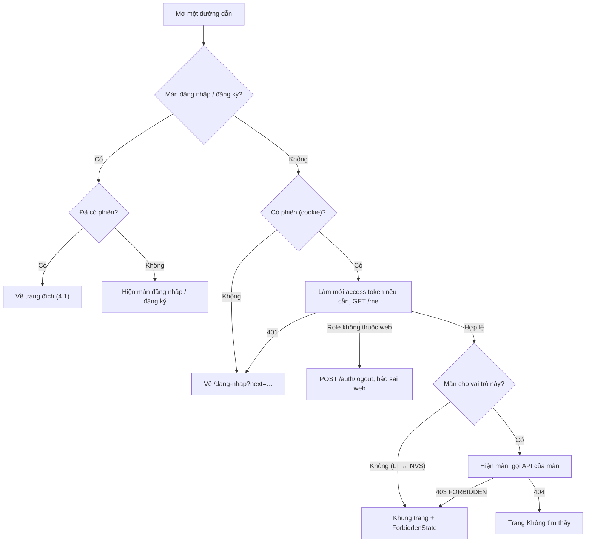

### 4.3 Màn hiển thị theo vai trò (tóm tắt Auth 9)

| Web | Vai trò | Màn được vào |
| --- | --- | --- |
| Khách hàng | Ẩn danh | CW-01, CW-02 |
| Khách hàng | KH | CW-03 → CW-13 |
| Nhân viên | Ẩn danh | SW-01 |
| Nhân viên | LT | SW-02, SW-03, SW-04 → SW-10, SW-14, SW-15 |
| Nhân viên | NVS | SW-02, SW-03, SW-11 → SW-13, SW-14, SW-15 |
| Quản lý | Ẩn danh | MW-01 |
| Quản lý | QL | MW-02 → MW-13 |

Ẩn/hiện menu chỉ là giao diện; quyền thật luôn do backend kiểm tra (Auth 2, nguyên tắc 3 và 7).

---

## 5. Luồng nhiều bước

Mỗi luồng ghi màn hình (mã), API được gọi (theo `openapi.yaml`) và nhánh lỗi chính. Thông báo lỗi lấy từ error envelope theo `Frontend-Conventions.md` mục 5.

### UF-01 – Khách hàng đặt lịch spa (UC-10)

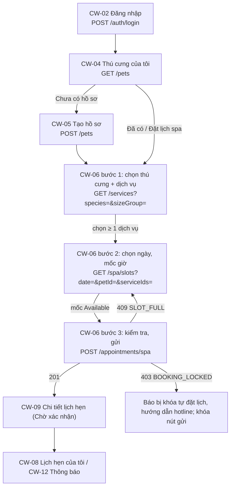

- Mốc `Full` và `NotAccepted` không chọn được; 409 `SLOT_FULL` thì quay lại bước 2, tải lại mốc giờ và hiện “Mốc giờ vừa kín, vui lòng chọn mốc khác.” (SA 6.6).
- Đổi thú cưng hoặc dịch vụ ở bước 1 thì xóa mốc giờ đã chọn ở bước 2 (thời lượng, số nhân viên cần thay đổi) **(Suy ra)**.

### UF-02 – Khách hàng đặt lịch lưu trú (UC-28)

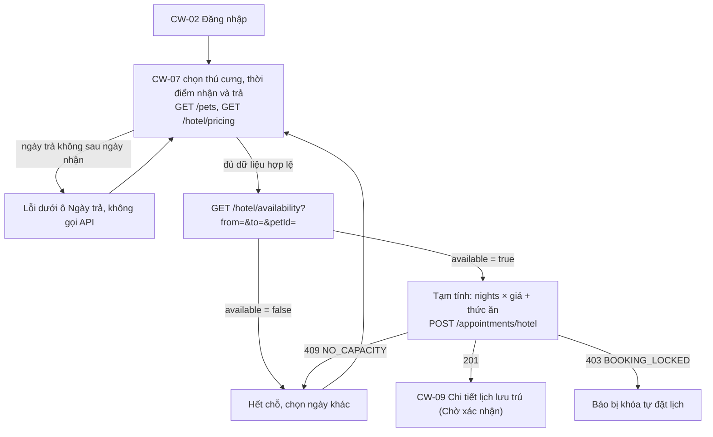

### UF-03 – Luồng tại quầy của lễ tân (UC-04, 16, 17, 23, 30 – 32)

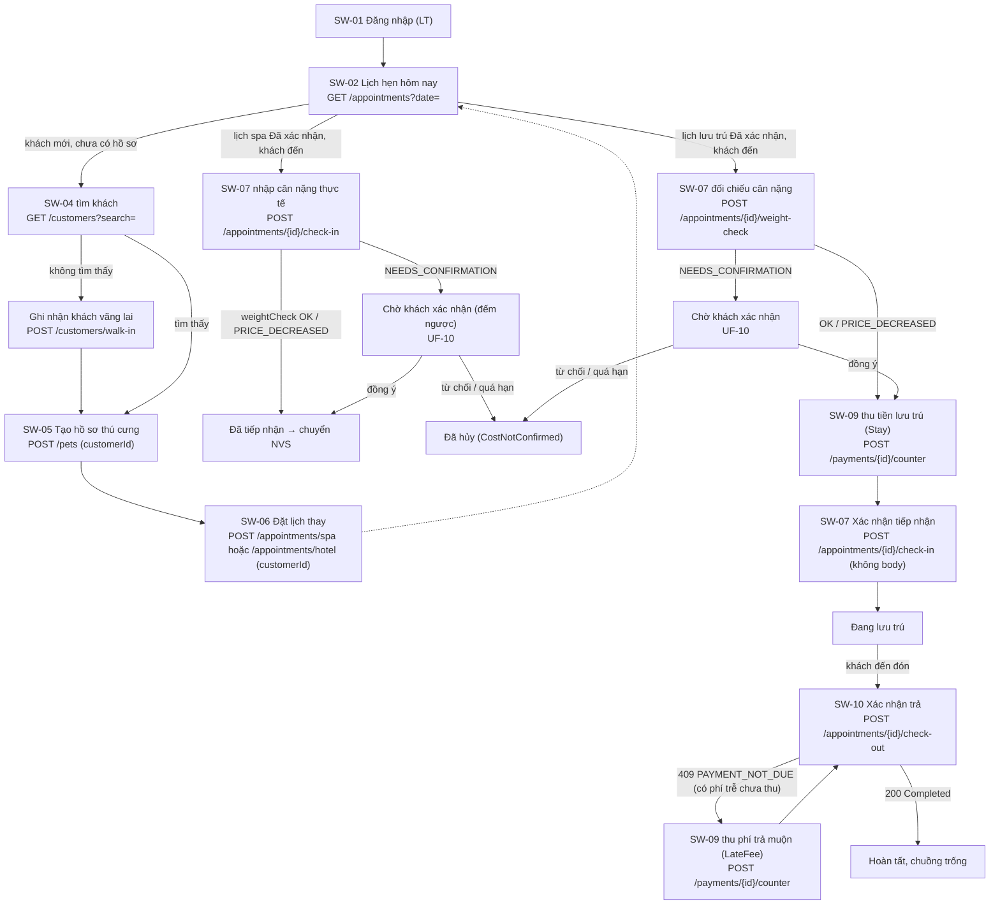

- Tiếp nhận spa chỉ hợp lệ trong thời gian giữ chỗ sau giờ hẹn; quá hạn thì lịch đã bị hủy do vắng mặt (UC-21) – API trả 409 `INVALID_TRANSITION`, màn tải lại danh sách.
- Khách vãng lai không nhận thông báo; lễ tân báo trực tiếp (UC-04, UC-34).

### UF-04 – Quản lý xử lý lịch chờ xác nhận (UC-12, 13, 29)

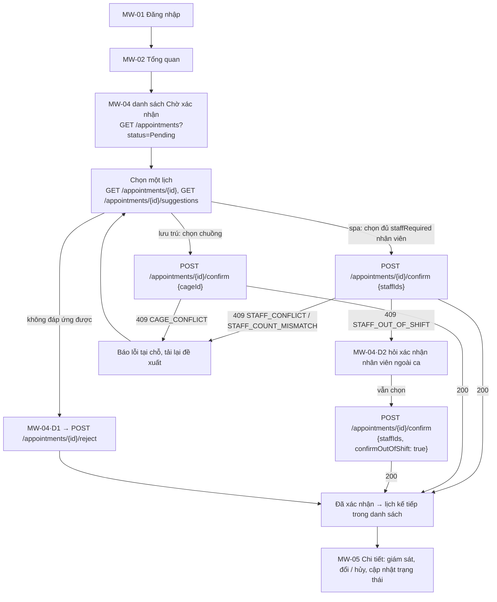

### UF-05 – Nhân viên spa thực hiện dịch vụ (UC-18, 19)

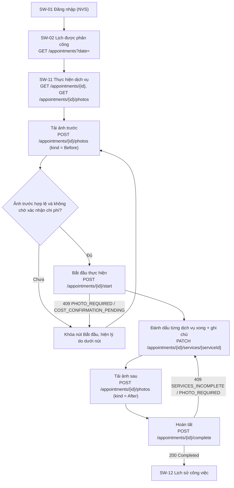

### UF-06 – Đổi hoặc hủy lịch hẹn (UC-14, 15)

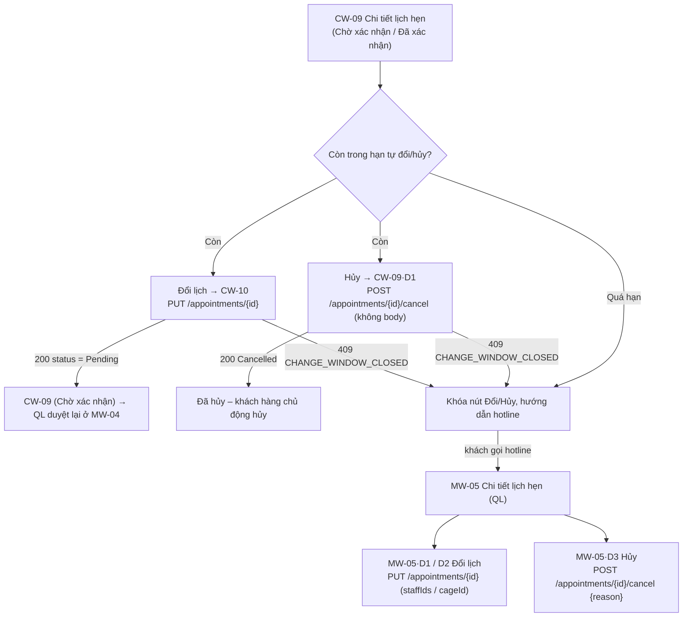

Web khách hàng không đọc được `Booking.ChangeCancelDeadlineMinutes` (`GET /config` chỉ dành cho QL), nên điều kiện “còn hạn” được biết chắc chắn qua phản hồi 409 `CHANGE_WINDOW_CLOSED` – xem UI-Screens mục 7, G-03.

### UF-07 – Quản lý phân ca nhân viên spa (UC-35)

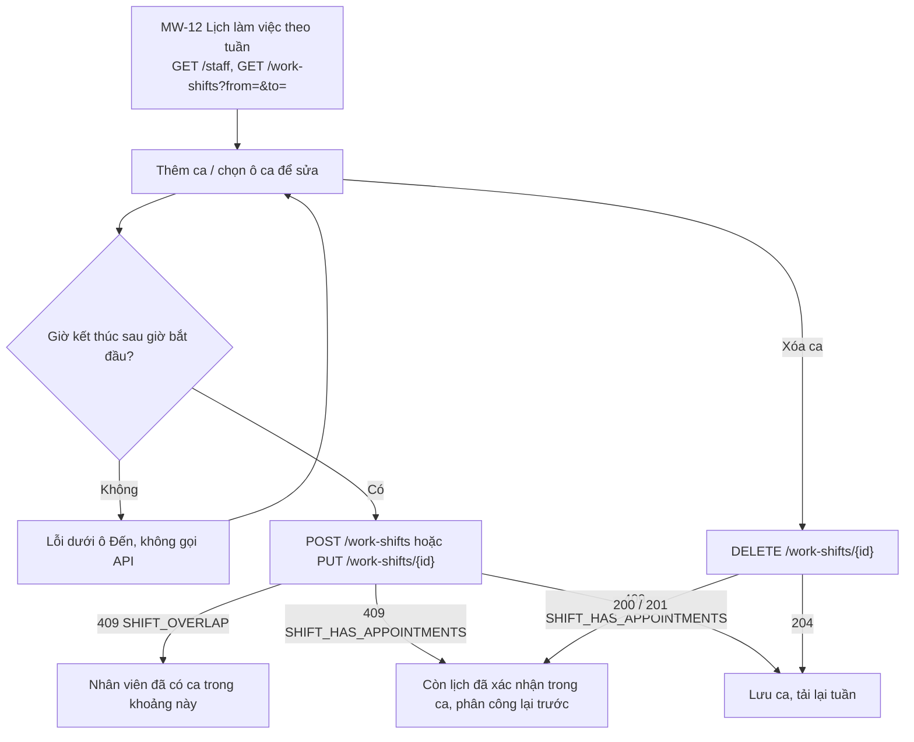

### UF-08 – Đăng nhập, làm mới phiên, đăng xuất (UC-02, SD-01) **(Đề xuất, theo cơ chế ở Frontend-Architecture mục 6)**

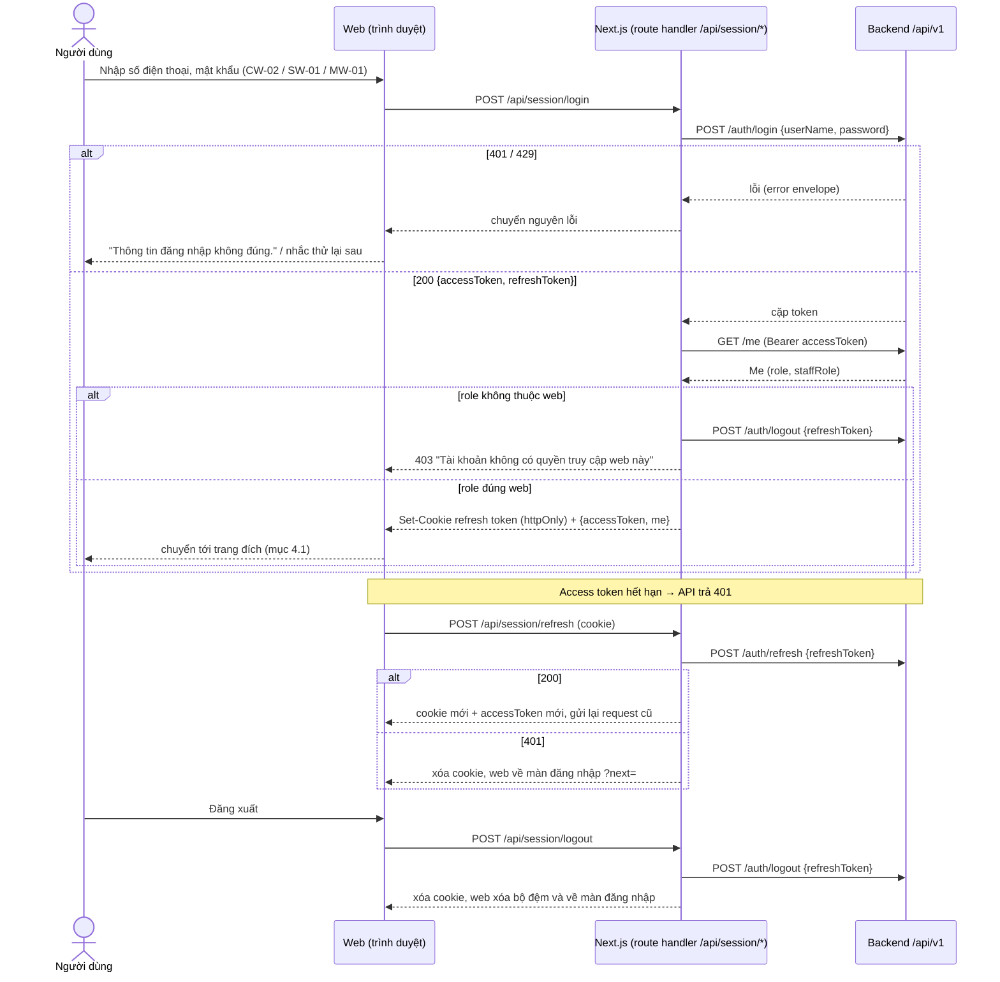

### UF-09 – Đăng ký tài khoản (UC-01)

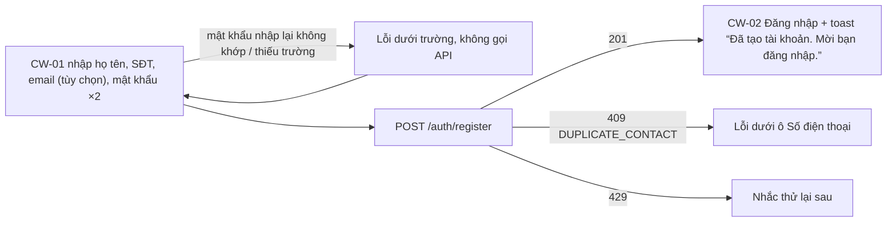

### UF-10 – Xác nhận chi phí mới (UC-30, BR-23) **(Bổ sung)**

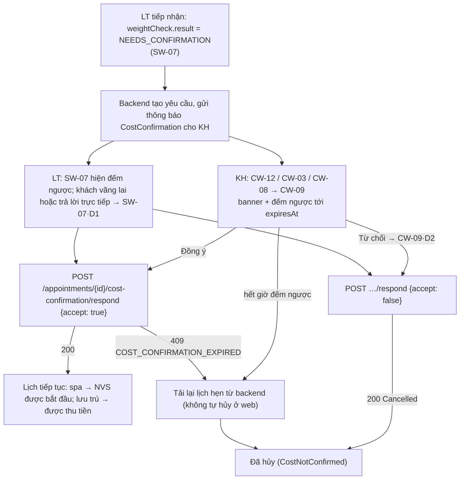

### UF-11 – Thanh toán trực tuyến lịch spa (UC-24, SD-05)

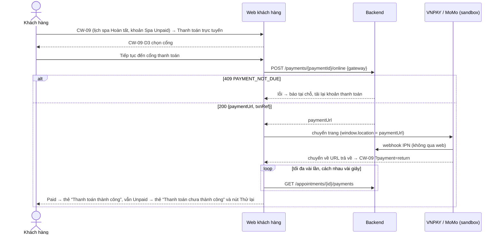

URL trả về do backend cấu hình (`Payment__Vnpay__*`, `Payment__Momo__*`); đề xuất trỏ về `/lich-hen/{appointmentId}?payment=return` – cần BE chốt (UI-Screens mục 7, G-15).

---

## 6. Điểm cần chốt liên quan điều hướng

| # | Vấn đề | Đề xuất | Ai chốt |
| --- | --- | --- | --- |
| N-01 | Menu và đường dẫn `manager-web` trên `develop` khác SA 6.2 và UI demo (mục 2.3). | Sửa mã theo mục 2.3 trong một thẻ riêng của web quản lý. | Nhóm FE |
| N-02 | Đường dẫn con (CW-05, CW-09, CW-10, SW-03, SW-05, SW-11, MW-05) và tham số truy vấn chưa có trong mã. | Dùng đúng bảng mục 2; thêm vào `lib/routes.ts` khi làm thẻ của màn đó. | Nhóm FE |
| N-03 | URL trả về sau thanh toán trực tuyến. | `/lich-hen/{appointmentId}?payment=return` trên web khách hàng. | BE + FE |
| N-04 | Cơ chế lưu phiên (R-01): refresh token trong cookie httpOnly qua route handler của Next.js. | Frontend-Architecture mục 6. | Nhóm |
| N-05 | Câu thông báo khi hết phiên và khi đăng nhập nhầm web. | Mục 4.2. | Nhóm FE |
